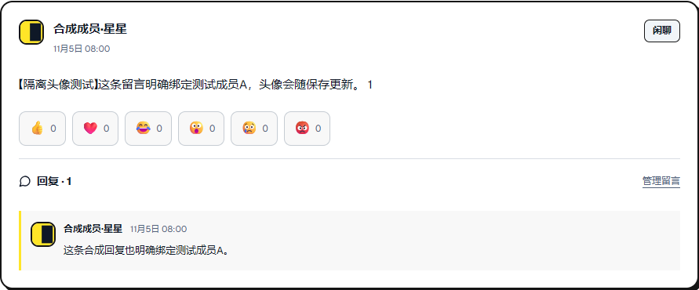
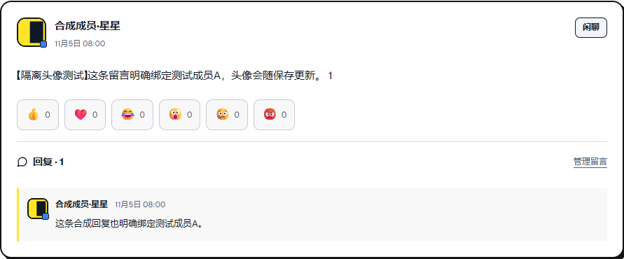
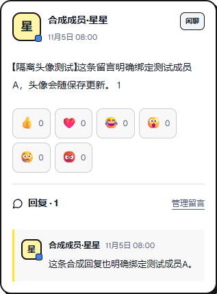
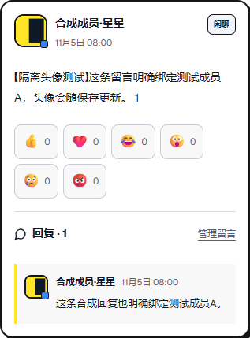

# 头像只换图，不换原框

## 修复与前后证据

认可基线807374...的实际运行证据：[avatar-baseline-results.json](avatar-baseline-results.json)。有照片时PublicAvatar直接返回MemberAvatar，主留言与回复均变为32px、10px圆角，并失去原颜色角标。现永远保留paper-avatar，仅新增内部image层。MemberAvatar继续只服务原型的32/48/64px资料展示，不再替代公开留言外框。

| 场景 | 原文字 / 修复后照片 | 基线照片（错误） | 修复后角标/阴影 |
|---|---|---|---|
| 留言主头像 | 42×42、12px角、2px深边 | 32×32、10px角 | 原位置、overflow visible；shadow none |
| 回复 | 30×30、8px角、2px深边 | 32×32、10px角 | 原位置保留；shadow none |
| 双行展播 | 30×30、9px角、2px深边 | 被MemberAvatar替代 | 沿用原展播设计；不新增角标 |

照片cover/center，内部层半径分别10/6/7px，只在内部裁切，外框及原标记CSS块没有修改。全局community-components.css负责照片尺寸/裁切，不依赖profile-lab.css。初次选择默认居中、无需展开裁剪选项；可选水平/垂直位置，仍以原函数生成128px WebP、输入≤2MB、输出≤40KB。

1440px对照：

| 基线照片 | 修复后照片 |
|---|---|
|  |  |

390px对照：

| 原文字框 | 修复后照片 |
|---|---|
|  |  |

展播：[桌面文字](avatar-ribbon-text-1440.png) / [桌面照片](avatar-ribbon-photo-1440.png) / [手机文字](avatar-ribbon-text-390.png) / [手机照片](avatar-ribbon-photo-390.png)。两行来源和布局未变。

## 实测方法与边界

`avatar-frames.cjs`运行真实导出页面、实际MessageWall/回复/MessageShowcase组件，数据只用显式合成账号。两种宽度各执行文字→照片→再换图→404缺图→恢复默认，8组结果见[avatar-frame-results.json](avatar-frame-results.json)。DOM记录每个框的相对bounding box、border/color/radius/shadow/overflow及角标，同时比较卡片宽高、轨道宽高和data-distance。图片状态不进入几何比较，其他属性逐项相等。

像素不是只做感知近似：截图PNG在浏览器canvas读取RGBA，每个改变像素都需落在原2px外框内的圆角内容覆盖范围，其他像素精确相等。两宽度的替换/再次替换均为范围外0差异；缺图与恢复默认对整个截图也为0差异。

截图原点存在小数，按实际截图栅格原点记录pixelX/Y；测试只把原型状态文案宿主固定72px，避免“保存成功”文案换行改变截图位置。未给产品添加这个高度，未隐藏留言或改动头像样式。焦点与鼠标状态保持一致，reduced-motion使展播静止。

**抗锯齿说明**：圆角内沿像素是图片颜色与描边颜色的混合，不能用像素中心是否落在理想圆内判断整个像素的覆盖。严格中心点中间检查在桌面出现19/20个混色像素（保留avatar-point-mask-intermediate.json）；最终用像素方块覆盖及0.25px栅格抗锯齿余量，仍不越过原2px外框矩形界线。没有把这些中间差异当成结构移动或掩盖成“所有描边RGB绝对相同”。外框几何、纯外框/周围结构与角标仍按上述规则核对。

`browser-checks.cjs`另覆盖保存失败保留旧图、非法格式/伪图片/超限、同名游客不认领、账号切换/过期及无后端请求；`contracts.cjs`检查JPEG/WebP/128px/刷新/清理。它们证明本机隔离原型行为，不能证明服务端上传或账号认证。

移动原型实际解码/编码/IndexedDB性能见[avatar-performance.json](avatar-performance.json)和avatar-mobile.trace.json.gz。输入1200×900合成PNG，输出128×128 WebP1174字节，CPU6×条件下单次裁剪就绪150ms、观察到保存207ms；包含自动化开销，不代表真实HTTP上传。CSP不允许fetch(blob:)时，测量通过只读IndexedDB取得实际Blob属性，没有放宽connect-src。

真实会话、存储、服务端重编码、授权、限流与生产头像均未上线。所有截图均为合成数据，不修改成员原介绍或工号资料。

额外[avatar-css-scope-results.json](avatar-css-scope-results.json)在实际浏览器禁用仅含profile-lab/MemberAvatar的独立stylesheet后，真实PublicAvatar仍是42px外框、38px有效图片区、cover/center，全部计算属性相等且animation=none；证明新规则没有依赖测试页面专属CSS。
